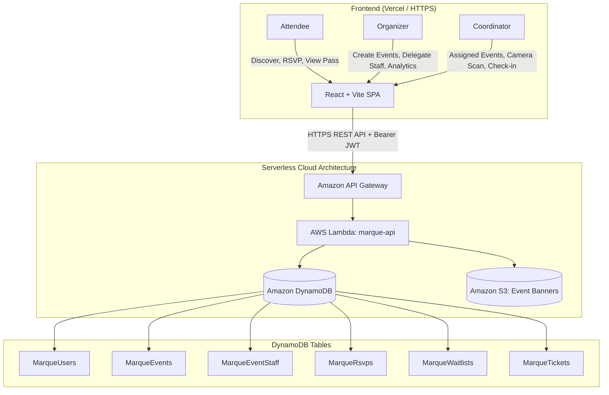
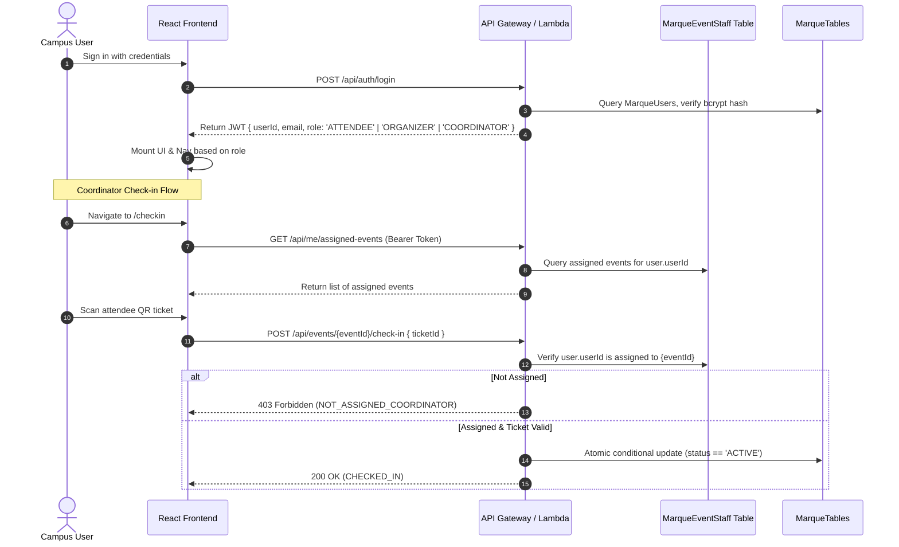

# Architecture

## 1. High-Level Design

The frontend is a single-page application hosted on Vercel over HTTPS. Amazon API Gateway exposes the backend REST API. A single serverless Node.js AWS Lambda function (`marque-api`) acts as the request processor with internal router, controller handlers, service orchestration, repositories, and authentication/authorization middleware.

## 2. Four Core AWS Services

### Amazon API Gateway
- Public REST/HTTP API entry point; routes HTTP requests to Lambda.
- Strict CORS configuration allowing the deployed Vercel frontend origin.
- Token validation is handled by custom Lambda middleware (`authMiddleware`) verifying HMAC SHA-256 signatures, user identity, and stakeholder role claims.

### AWS Lambda
- Processes authentication, event CRUD, capacity allocation, FIFO waitlist promotions, digital pass issuance, event-staff assignment, and single-use check-in.
- Validates request schemas and verifies role authorizations (`ATTENDEE`, `ORGANIZER`, `COORDINATOR`).
- Implements event-scoped coordinator authorization checks via the `MarqueEventStaff` repository.

### Amazon DynamoDB
- Stores relational data in isolated, pay-per-request tables:
  1. `MarqueUsers`: Registered campus accounts and system roles.
  2. `MarqueEvents`: Campus event records and confirmed attendee tallies.
  3. `MarqueEventStaff`: Event-scoped coordinator delegations (`eventId` + `userId`).
  4. `MarqueRsvps`: Individual RSVP registrations and state machines.
  5. `MarqueWaitlists`: FIFO queue entries sorted chronologically.
  6. `MarqueTickets`: Opaque ticket codes, active state, and single-use check-in logs.
- Uses conditional writes (`attribute_not_exists`, `confirmedCount < capacity`, `status = :active`) and atomic transactions (`TransactWriteItems`) to prevent overbooking and race conditions.

### Amazon S3
- Private object bucket storing optional campus event banner graphics.
- Uploads occur via short-lived AWS presigned URLs generated by the Lambda backend.
- Strictly no sensitive attendee records or credentials stored in S3.

## 3. Stakeholder Authentication & Role-Based Authorization Flow

1. **Stateless JWT Issuance:** On authentication, the backend signs a JWT with the user's ID, email, and role.
2. **Client-Side Route Protection:** `AppRoutes.jsx` and `Sidebar.jsx` prevent unauthorized navigation:
   - Attendees only see Discover Events and My RSVPs; never scanner or organizer links.
   - Organizers see Manage Events and Analytics.
   - Coordinators see Assigned Events and the Check-in Workspace.
3. **Backend Authorization Enforcement:** Frontend route guards provide UX guidance, but the backend is the authoritative boundary:
   - Event creation/editing requires `user.role === 'ORGANIZER'`.
   - Modifying an event requires `event.organizerId === user.userId`.
   - Assigning/revoking coordinators requires `event.organizerId === user.userId`.
   - Check-in endpoints require either event ownership OR active assignment in `MarqueEventStaff`.
   - Attendees attempting check-in or organizer endpoints receive HTTP 403 Forbidden.

## 4. RSVP, Capacity & FIFO Waitlist Flow

1. **Conditional Registration:** The attendee requests RSVP (`POST /api/events/{eventId}/rsvp`).
2. If `event.confirmedCount < event.capacity`, a DynamoDB transaction increments `confirmedCount`, creates a `CONFIRMED` RSVP, and issues an active opaque ticket (`tkt-xxxxxxxx`).
3. If capacity is exhausted, the attendee is placed into `MarqueWaitlists` with a FIFO queue key (`ISO_TIMESTAMP#userId`). The RSVP status is set to `WAITLISTED`.
4. **Cancellation & Promotion:** When a confirmed attendee cancels (`DELETE /api/events/{eventId}/rsvp`), the transaction queries the earliest waiting record from `MarqueWaitlists`. If found, that attendee is promoted to `CONFIRMED`, issued an active ticket, and the capacity count remains steady. If the waitlist is empty, `confirmedCount` decrements by 1.

## 5. Event-Scoped Venue Check-in Architecture

1. **Staff Assignment:** Organizers delegate coordinators using `POST /api/events/{eventId}/staff` with the coordinator's campus email. This writes a record to `MarqueEventStaff` linking `eventId` and `userId`.
2. **Event Scoping:** When a coordinator visits `/checkin`, the app queries `GET /api/me/assigned-events`. The coordinator is only presented with events they are authorized to operate.
3. **QR Verification:** The QR code displays strictly the opaque ticket ID.
4. **Atomic Check-in:** The coordinator submits `POST /api/events/{eventId}/check-in`. Lambda validates:
   - Caller is the event owner OR listed in `MarqueEventStaff` for this `eventId`.
   - Ticket exists and belongs to this `eventId`.
   - Ticket is currently `ACTIVE` (not cancelled, waitlisted, or already checked in).
5. A DynamoDB conditional update marks the ticket `CHECKED_IN`, logs `checkedInAt` and `checkedInBy`, and prevents duplicate check-ins.

## 6. Deployment Boundaries

- **Frontend:** Vercel over HTTPS with `VITE_API_BASE_URL` pointing to the API Gateway stage endpoint.
- **Backend:** Monolithic serverless Node.js Lambda function fronted by Amazon API Gateway HTTP API.
- **Database:** DynamoDB on-demand pay-per-request tables.
