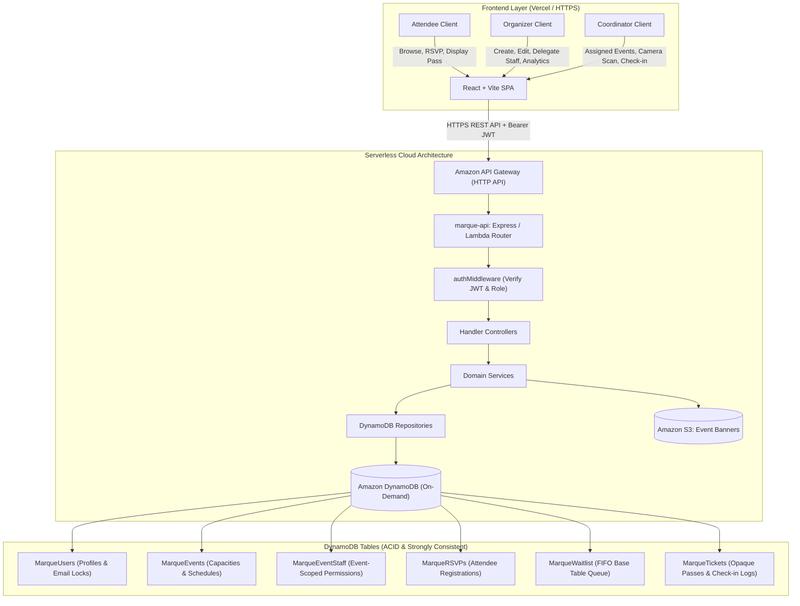
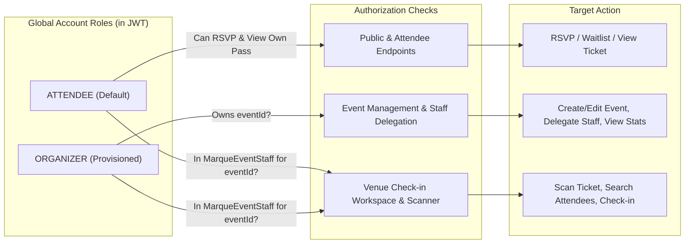
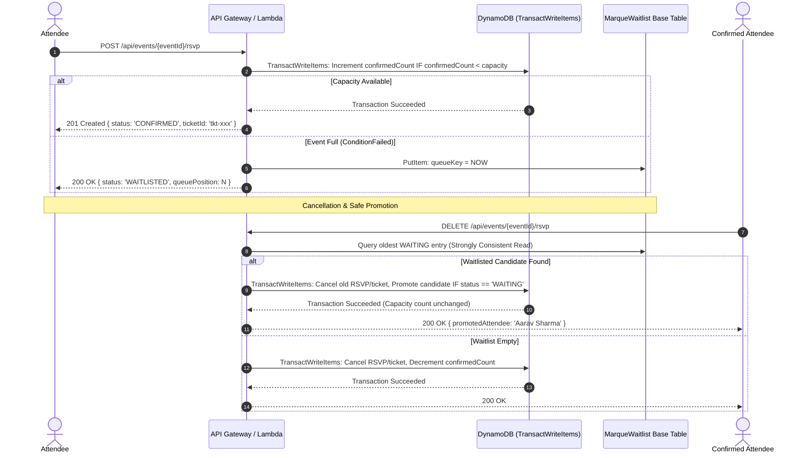
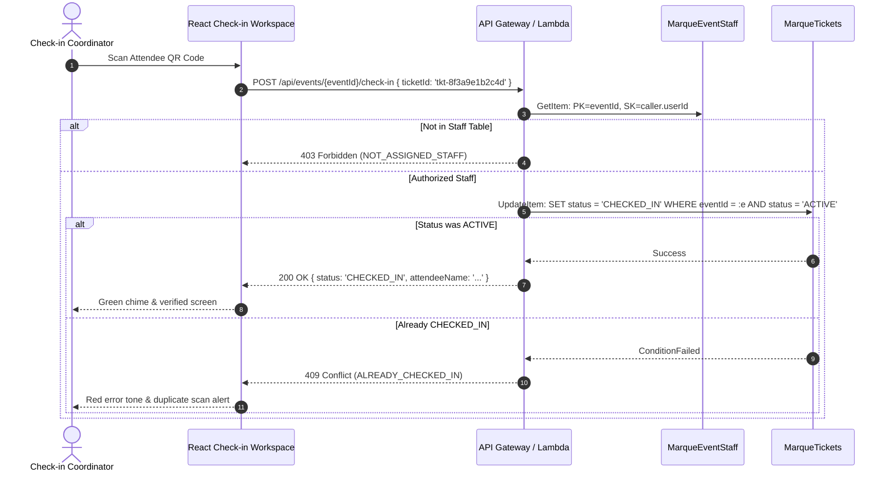

# Architecture — Final & Frozen Design

## 1. High-Level System Architecture

The system is organized into a clean separation of concerns:
1. **Frontend Presentation:** React 18 SPA hosted on Vercel over TLS 1.3. Communicates with AWS via a typed API client with zero client-side privilege assumptions.
2. **API Gateway:** Amazon API Gateway HTTP API routing all `/api/*` traffic to a single monolithic serverless AWS Lambda function (`marque-api`).
3. **Application Routing & Middleware:** A modular Node.js router that validates request bodies, unpacks Bearer JWTs, and verifies global roles and event-specific check-in permissions.
4. **Data Persistence:** DynamoDB on-demand tables executing multi-item atomic transactions (`TransactWriteItems`) for capacity allocation and seat reclamation.
5. **Asset Storage:** Private Amazon S3 bucket for optional event banner graphics accessed via presigned upload URLs.

---

## 2. Stakeholder Permissions & Authorization Flow

### Pure Two-Tier Global Roles + Event Delegation Rule
1. **Global Roles:** Only `ATTENDEE` and `ORGANIZER` exist as persistent account roles in `MarqueUsers` and JWT claims.
2. **Coordinator is NOT a Global Role:** Any registered user (`ATTENDEE` or `ORGANIZER`) can be assigned as a coordinator for a specific event. The user's account role is never mutated.
3. **Event Scoping:** When an organizer assigns a coordinator, an item is created in `MarqueEventStaff` (`PK: eventId`, `SK: userId`).
4. **Zero Automatic Scanner Access:** Organizers do not automatically gain check-in permissions. To scan tickets, the organizer's own account must have a record in `MarqueEventStaff`.
5. **Immediate Revocation:** Deleting an assignment immediately invalidates check-in access on the subsequent request because the Lambda backend queries `MarqueEventStaff` directly.

---

## 3. RSVP, Capacity & FIFO Waitlist Concurrency Flow

---

## 4. Single-Use Venue Check-In Architecture

---

## 5. Table to Access Pattern Mapping

| Table / GSI | Primary Access Patterns Serviced | Consistency Mode |
| :--- | :--- | :--- |
| `MarqueUsers` (`userId` + `itemType`) | AP-02 (User Profile), AP-01 via Email Locks | Strongly Consistent |
| `MarqueUsers.email-index` | AP-01 (Normalized Email Lookup during Login / Staff Assignment) | Eventually Consistent |
| `MarqueEvents` (`eventId`) | AP-04 (Event Details), Capacity Conditional Updates | Strongly Consistent |
| `MarqueEvents.status-startAt-index` | AP-03 (Public Event Discovery & Filtering) | Eventually Consistent |
| `MarqueEvents.organizer-index` | AP-05 (Organizer Dashboard Events List) | Eventually Consistent |
| `MarqueEventStaff` (`eventId` + `userId`) | AP-06 (List Event Staff), AP-07 (Staff Check-in Verification) | Strongly Consistent |
| `MarqueEventStaff.user-assigned-events-index` | AP-08 (List Events Assigned to User) | Eventually Consistent |
| `MarqueRSVPs` (`eventId` + `attendeeId`) | AP-10 (Check Attendee RSVP Status), Duplicate Prevention | Strongly Consistent |
| `MarqueRSVPs.attendee-index` | AP-09 (My RSVPs Registrations List) | Eventually Consistent |
| `MarqueWaitlist` (`eventId` + `queueKey`) | AP-11 (Oldest Waitlist FIFO Candidate Query for Promotion) | **Strongly Consistent** |
| `MarqueWaitlist.attendee-waitlist-index` | Locate User Queue Item on Self-Cancellation | Eventually Consistent |
| `MarqueTickets` (`ticketId`) | AP-12 (Single Ticket Query), AP-14 (Atomic Check-in) | Strongly Consistent |
| `MarqueTickets.event-attendees-index` | AP-13 (Attendee Registry Search for Check-in Staff) | Eventually Consistent |

---

## 6. Deployment Boundaries & Infrastructure Wiring

- **Frontend Hosting:** Vercel over TLS 1.3. Environment variable `VITE_API_BASE_URL` points directly to the deployed API Gateway HTTP API stage endpoint.
- **Backend Execution:** Serverless Node.js 22.x Lambda function fronted by Amazon API Gateway HTTP API with CORS configuration matching the Vercel domain.
- **Persistence Layer:** Amazon DynamoDB on-demand pay-per-request tables with point-in-time recovery (PITR) enabled.
- **Media Storage:** Amazon S3 private bucket for organizer banner graphics configured with Block Public Access and short-lived presigned upload URLs.
