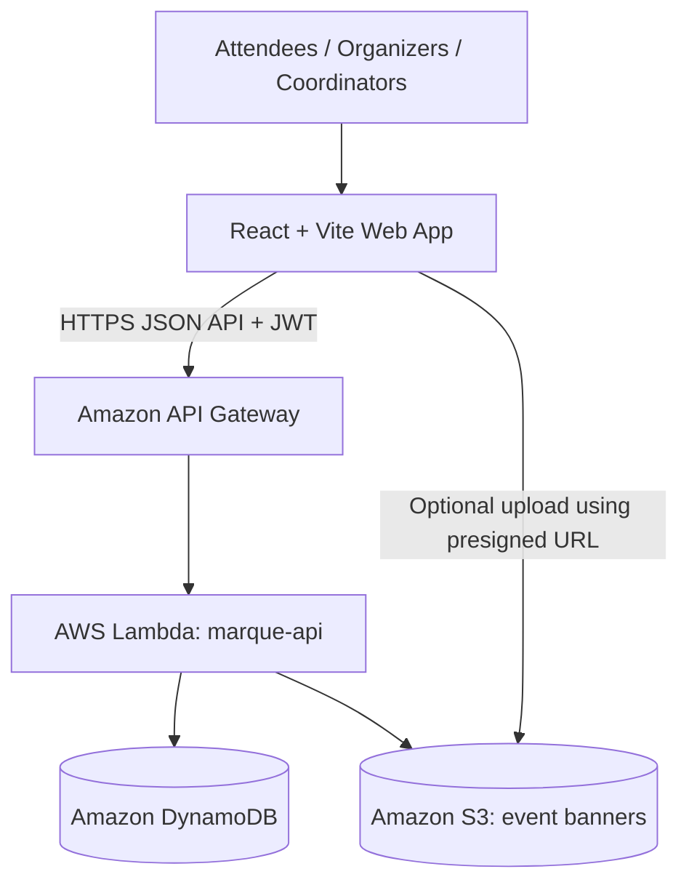

# Architecture

## 1. High-level design

The frontend is hosted on Vercel over HTTPS. API Gateway exposes the backend API. One Lambda function is the initial MVP entry point; its code is divided into handlers, services, repositories, and shared utilities. This avoids managing many Lambda deployments while preserving clean code boundaries.

## 2. Four core AWS services

### Amazon API Gateway
- Public API entry point; routes HTTP requests to Lambda.
- Configure CORS for the deployed frontend origin.
- For this custom JWT setup, shared Lambda authentication middleware verifies tokens. Do not configure an API Gateway managed JWT authorizer unless a compatible issuer/JWKS provider is introduced.

### AWS Lambda
- Runs authentication, event, RSVP, waitlist, ticket, check-in, and statistics logic.
- Validates request data and application roles.
- Uses shared modules to verify JWTs and produce consistent responses.
- Accesses DynamoDB and creates presigned S3 URLs when needed.

### Amazon DynamoDB
- Stores user profiles, events, RSVPs, waitlist entries, and ticket state.
- Uses conditional writes and transactions to prevent overbooking and duplicate check-in.
- The backend, not the frontend, is the source of truth for registration status and capacity.

### Amazon S3
- Stores optional event banner images.
- Keep the bucket private; prefer short-lived presigned URLs for authorized uploads.
- Do not store passwords, JWTs, or sensitive attendee data in S3.

## 3. Authentication flow

1. User registers or signs in through the frontend.
2. Lambda verifies credentials against the user record; passwords are stored only as bcrypt hashes.
3. Login returns a signed JWT containing a user ID and role, with an expiry.
4. The frontend sends `Authorization: Bearer <token>` for protected requests.
5. Shared Lambda middleware verifies the signature, expiry, and role requirements.
6. Lambda accesses AWS resources using its execution role.

**IAM distinction:** The Lambda execution role is mandatory infrastructure permission. It is not the application-user login mechanism.

## 4. RSVP and waitlist flow

- The backend checks for an existing active RSVP.
- A DynamoDB transaction conditionally increments the confirmed count only if capacity remains, updates/creates the RSVP, and creates the ticket record.
- If capacity is full, the backend creates a waitlist entry with a queue key based on creation time and attendee ID.
- Cancellation and promotion must use conditional updates/transactions. If a concurrent request changes the selected waitlist entry, retry promotion rather than promoting it twice.
- If no eligible waitlisted attendee exists, cancellation decrements the confirmed count. If someone is promoted, the released seat is transferred and the confirmed count can remain unchanged.

## 5. QR check-in flow

- QR code contains an opaque ticket ID only.
- Scanner reads the ticket ID and sends it to the check-in API.
- Backend checks ticket, event, RSVP status, and current check-in state.
- A conditional update marks the ticket as checked in only if it is eligible and has not already been used.
- Manual lookup calls the same validation/check-in logic; it is not a security bypass.

## 6. Deployment boundaries

- Frontend: Vercel, with `VITE_API_BASE_URL` configured to the API Gateway URL.
- Backend: one Node.js Lambda function integrated with an API Gateway HTTP API.
- Database: DynamoDB tables in the same AWS region as Lambda.
- Assets: private S3 bucket for event banners.
- Operational logs: Lambda logs are available through CloudWatch as part of AWS operations; CloudWatch is not counted as an additional core application service in project scope.
