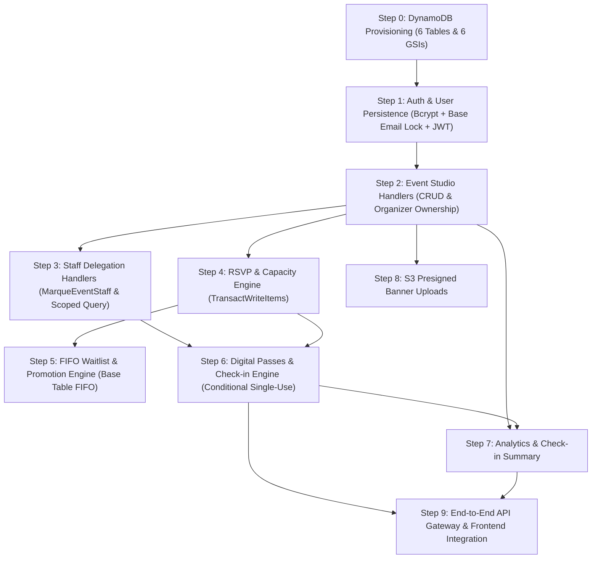

# Implementation Plan — Backend Engineering & Integration

This document outlines the dependency-ordered execution plan for implementing the serverless AWS backend based on the frozen API Contract and DynamoDB specifications.

---

## 1. Dependency-Ordered Implementation Sequence

---

## 2. Phase-by-Phase Execution

### Phase 1: Infrastructure & Data Persistence Foundation
1. **DynamoDB Table Setup:**
   - Provision the 6 on-demand tables defined in `DATABASE_DESIGN.md`:
     - `MarqueUsers` (`userId` + `itemType`): No GSI needed. Atomic email uniqueness lock record (`EMAIL#<normalizedEmail>`, `itemType: LOCK`) allows strongly consistent base table reads for authentication and staff lookup.
     - `MarqueEvents` (`eventId`): GSIs `status-startAt-index` and `organizer-index`.
     - `MarqueEventStaff` (`eventId` + `userId`): GSI `user-assigned-events-index`.
     - `MarqueRSVPs` (`eventId` + `attendeeId`): GSI `attendee-index`. Stores `queueKey` for waitlisted attendees.
     - `MarqueWaitlist` (`eventId` + `queueKey`): No GSI needed. Stores active waiting entries only; entries are deleted on promotion or cancellation.
     - `MarqueTickets` (`ticketId`): GSIs `event-attendees-index` and `attendee-tickets-index`.
   - **Total GSIs across entire system: Exactly 6.**
2. **Lambda Configuration:**
   - Configure Node.js 22.x Lambda execution environment with IAM role granting access strictly to the 6 tables, their 6 GSIs, banner S3 bucket, and CloudWatch Logs.
   - Configure environment variables: `USERS_TABLE`, `EVENTS_TABLE`, `EVENT_STAFF_TABLE`, `RSVPS_TABLE`, `WAITLIST_TABLE`, `TICKETS_TABLE`, `JWT_SECRET`, `S3_BUCKET`.

### Phase 2: Authentication & Event Studio (Neilsen)
1. **Auth Handlers:**
   - Implement `POST /api/auth/register` with atomic email lock in `MarqueUsers` and bcrypt hashing. Always assign `role: "ATTENDEE"`.
   - Implement `POST /api/auth/login` issuing signed JWT with claims `{ userId, email, role }`. Performs strongly consistent 2-step base table read using the email lock item.
2. **Event Handlers:**
   - Implement `GET /api/events` and `GET /api/events/{eventId}`.
   - Implement `POST /api/events` (Organizer only, wraps response in `{ "event": ... }`).
   - Implement `PATCH /api/events/{eventId}` with ownership check (`event.organizerId === user.userId`) and capacity reduction floor validation (wraps response in `{ "event": ... }`).
3. **Staff Delegation Handlers:**
   - Implement `GET /api/events/{eventId}/staff` (Owner only).
   - Implement `POST /api/events/{eventId}/staff` (Lookup target user via email lock; require user account to already exist; write to `MarqueEventStaff` with `permission: "CHECK_IN"`).
   - Implement `DELETE /api/events/{eventId}/staff/{userId}` (Owner only).
   - Implement `GET /api/me/assigned-events` (Query `user-assigned-events-index`, returning only explicit staff assignments).

### Phase 3: Transactional RSVP, Waitlist & Single-Use Check-in (Preeti)
1. **Capacity-Safe RSVP Engine:**
   - Implement `POST /api/events/{eventId}/rsvp` using `TransactWriteItems` with condition `confirmedCount < capacity`.
   - On condition failure, fallback to inserting `MarqueWaitlist` with `queueKey = NOW#userId` and returning `200 OK` (`WAITLISTED`).
2. **Safe Cancellation & Deterministic Promotion:**
   - Implement `DELETE /api/events/{eventId}/rsvp`.
   - Query oldest waiting entry on `MarqueWaitlist` base table using **Strongly Consistent Reads** (`Limit = 1`, no filter expression).
   - If candidate found, execute atomic promotion transaction (transactionally deleting the waitlist entry from `MarqueWaitlist`); if empty, decrement `confirmedCount`.
   - Waitlisted attendees cancelling their RSVP delete directly from `MarqueWaitlist` using the `queueKey` recorded on `MarqueRSVPs`.
3. **Digital Pass & Check-in Handlers:**
   - Implement `GET /api/tickets/{ticketId}` (Ticket owner only).
   - Implement `GET /api/events/{eventId}/attendees` (Query parameter `q` min 2 chars required for staff; returns masked email).
   - Implement `POST /api/events/{eventId}/check-in`:
     - Verify explicit assignment in `MarqueEventStaff` for `eventId` (required for all callers, including organizers).
     - Execute conditional update `#status = :checkedIn` WHERE `#status = :active`.
     - Return 409 `ALREADY_CHECKED_IN` on repeat attempts.
4. **Analytics Handlers:**
   - Implement `GET /api/events/{eventId}/stats` (Organizer owner only).
   - Implement `GET /api/events/{eventId}/checkin-summary` (Assigned staff in `MarqueEventStaff`).

### Phase 4: API Gateway Wiring & Frontend Integration
1. Configure API Gateway HTTP API routes mapping `$default` to `marque-api` Lambda.
2. Enable CORS with permitted origin matching the Vercel frontend domain.
3. Set `VITE_API_BASE_URL` in frontend environment; verify all mock fallbacks are completely disabled in real API mode.
4. Run automated test suite against the deployed AWS staging API.
